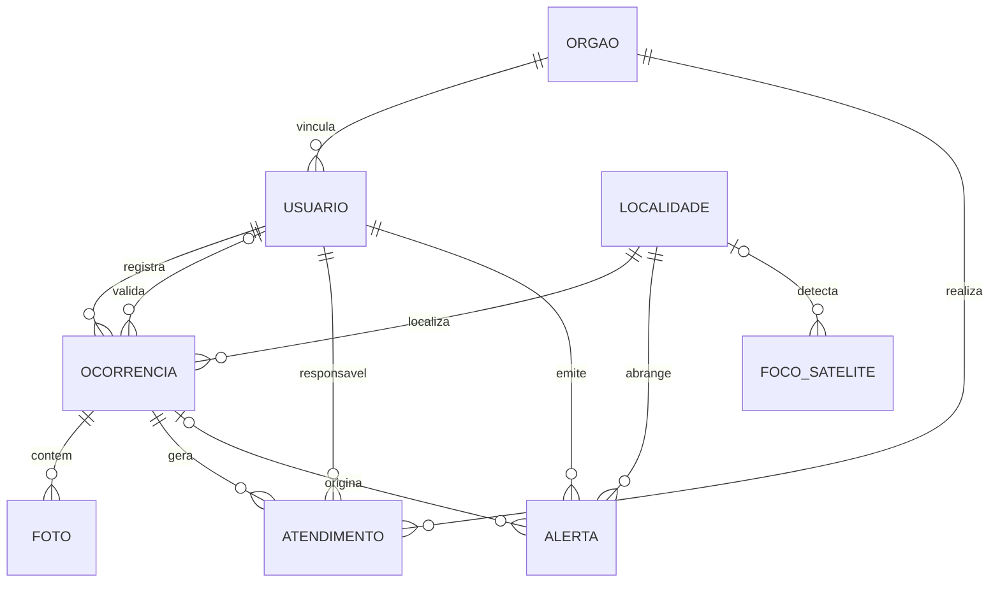

# Alerta Fogo Araguaia – Banco de Dados

Banco de dados relacional do **Alerta Fogo Araguaia**, sistema proposto na ação de
extensão do Programa de Extensão UFMS Digital para o enfrentamento das queimadas
em **Bom Jesus do Araguaia (MT)**. Moradores registram focos de queimada com
localização e fotos; agentes públicos da Câmara Municipal e de órgãos parceiros
validam as ocorrências, registram o atendimento e emitem alertas de risco; os
registros da comunidade são cruzados com os focos de calor do BDQueimadas (INPE).

Projeto desenvolvido para o **Módulo 3 – Banco de Dados e Controle de Versão**.

## Tecnologias

| Ferramenta | Uso |
|---|---|
| PostgreSQL 16 | SGBD relacional (SQL padrão, `CHECK`, `ENUM`, triggers em PL/pgSQL, views) |
| pgcrypto | Hash bcrypt das senhas (`crypt` / `gen_salt`) |
| Git + GitHub | Controle de versão, branches por funcionalidade e integração contínua |
| GitHub Actions | Recria o banco e executa os testes a cada push |

## Estrutura do repositório

```
.
├── docs/
│   └── modelo-dados.md          # DER, dicionário, normalização e ciclo de vida
├── sql/
│   ├── schema/                  # DDL: criação do banco
│   │   ├── 01_extensoes_tipos.sql
│   │   ├── 02_tabelas_cadastro.sql     # orgao, localidade, usuario
│   │   ├── 03_tabelas_ocorrencia.sql   # ocorrencia, foto, atendimento
│   │   ├── 04_tabelas_alerta_foco.sql  # alerta, foco_satelite
│   │   ├── 05_regras_negocio.sql       # funções e triggers (RN01–RN04, RF03)
│   │   └── 06_views.sql                # mapa público, sugestões de alerta, fila
│   ├── dados/                   # INSERT: carga de dados fictícios de teste
│   ├── dml/                     # UPDATE e DELETE do dia a dia do sistema
│   └── consultas/consultas.sql  # 12 consultas de telas e relatórios
├── tests/test_regras_negocio.sql   # 34 testes automatizados das restrições
├── scripts/run_all.sh           # recria tudo do zero
└── .github/workflows/ci.yml     # integração contínua
```

## Modelo de dados

Oito tabelas, todas na terceira forma normal:



O dicionário de dados completo, as decisões de normalização e os ajustes em
relação ao DER do módulo 2 estão em [`docs/modelo-dados.md`](docs/modelo-dados.md).

**Restrições:** 8 chaves primárias, 12 chaves estrangeiras, 5 restrições de
unicidade, 18 `CHECK`, 3 tipos `ENUM` e 6 triggers de regras de negócio.

| Regra | Como o banco garante |
|---|---|
| RN01 – ocorrência nasce `PENDENTE` | trigger `trg_ocorrencia_antes_inserir` |
| RN02 – gravidade alta sugere alerta | view `vw_sugestao_alerta` |
| RN03 – só agente público com órgão valida, atende e alerta | `CHECK` em `usuario` + função `fn_exigir_agente_publico` |
| RN04 – encerrar exige atendimento; descartar exige justificativa | trigger `trg_ocorrencia_antes_atualizar` + `CHECK` |
| RF03 – até 5 fotos por ocorrência | trigger `trg_foto_limite` (com bloqueio de linha) |
| RNF05 – senha com hash | `pgcrypto` / bcrypt |
| RNF06 – privacidade (LGPD) | `vw_mapa_publico` sem dados do autor; anonimização em `dml/02_remocoes.sql` |

## Como executar

Pré-requisito: PostgreSQL 14 ou superior com o cliente `psql`.

```bash
# 1. Crie um banco vazio
createdb alerta_fogo

# 2. Crie o esquema, carregue os dados, execute UPDATE/DELETE e os testes
PGDATABASE=alerta_fogo ./scripts/run_all.sh

# 3. Execute as consultas
psql -d alerta_fogo -f sql/consultas/consultas.sql
```

No Windows (sem Bash), execute os arquivos na ordem pelo pgAdmin ou pelo `psql`:
`sql/schema/01` a `06`, `sql/dados/01` e `02`, `sql/dml/01` e `02`,
`tests/test_regras_negocio.sql` e, por fim, `sql/consultas/consultas.sql`.

O script apaga e recria o esquema `alerta_fogo`, portanto pode ser executado
quantas vezes for preciso. Saída esperada dos testes:

```
NOTICE:  ok  PK: órgão com id repetido
NOTICE:  ok  UNIQUE: e-mail de usuário repetido
...
NOTICE:  ok  ON DELETE CASCADE: fotos removidas com a ocorrência
Todos os testes passaram.
```

## Operações de manipulação de dados

| Arquivo | Conteúdo |
|---|---|
| `sql/dados/01_cadastros.sql` | `INSERT` de 5 órgãos, 7 localidades e 14 usuários (senhas com bcrypt) |
| `sql/dados/02_ocorrencias.sql` | `INSERT` de 13 ocorrências, 14 fotos, 7 atendimentos, 4 alertas e 18 focos, seguindo o ciclo de vida |
| `sql/dml/01_atualizacoes.sql` | `UPDATE`: validar, descartar, abrir e concluir atendimento, encerrar, reclassificar, atualizar cadastro; `INSERT ... SELECT` de alertas sugeridos |
| `sql/dml/02_remocoes.sql` | `DELETE`: foto, ocorrência com `CASCADE`, morador sem histórico, bloqueio por `RESTRICT`, anonimização (LGPD) e retenção de focos antigos |
| `sql/consultas/consultas.sql` | 12 consultas com `JOIN`, `LEFT JOIN`, `GROUP BY`, `FILTER`, subconsultas, `NOT EXISTS`, CTE, função de janela e cálculo de distância (haversine) |

> Todos os dados são **fictícios**. Nomes, telefones, e-mails e coordenadas foram
> criados apenas para teste e não correspondem a pessoas reais.
> Senha dos usuários de teste: `Teste@2026`.

## Controle de versão

* **Branch `main`** – sempre estável: todo commit nela recria o banco sem erros.
* **Branches de funcionalidade** – `feature/...`, `test/...` e `docs/...`, uma por
  etapa do projeto, integradas à `main` com `git merge --no-ff` para manter o
  histórico de cada etapa visível.
* **Commits pequenos e descritivos** no padrão
  [Conventional Commits](https://www.conventionalcommits.org/pt-br/):
  `feat(schema): ...`, `fix(regras): ...`, `test: ...`, `docs: ...`.
* **Tag `v1.0.0`** marca a primeira versão completa.
* **CI** no GitHub Actions executa `run_all.sh` em um PostgreSQL 16 limpo.

```bash
git log --oneline --graph --all   # visualizar o histórico
```

## Contexto

Ação de extensão “Alerta Fogo Araguaia: tecnologia e mobilização comunitária no
enfrentamento das queimadas em Bom Jesus do Araguaia (MT)” – Programa de
Extensão UFMS Digital (95DX7.200525), Universidade Federal de Mato Grosso do Sul.
