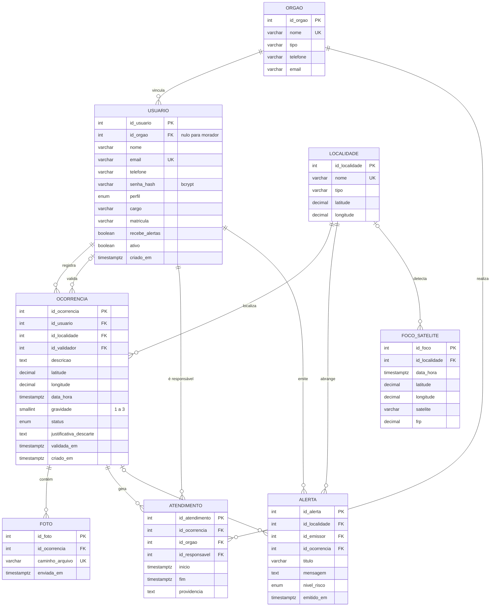
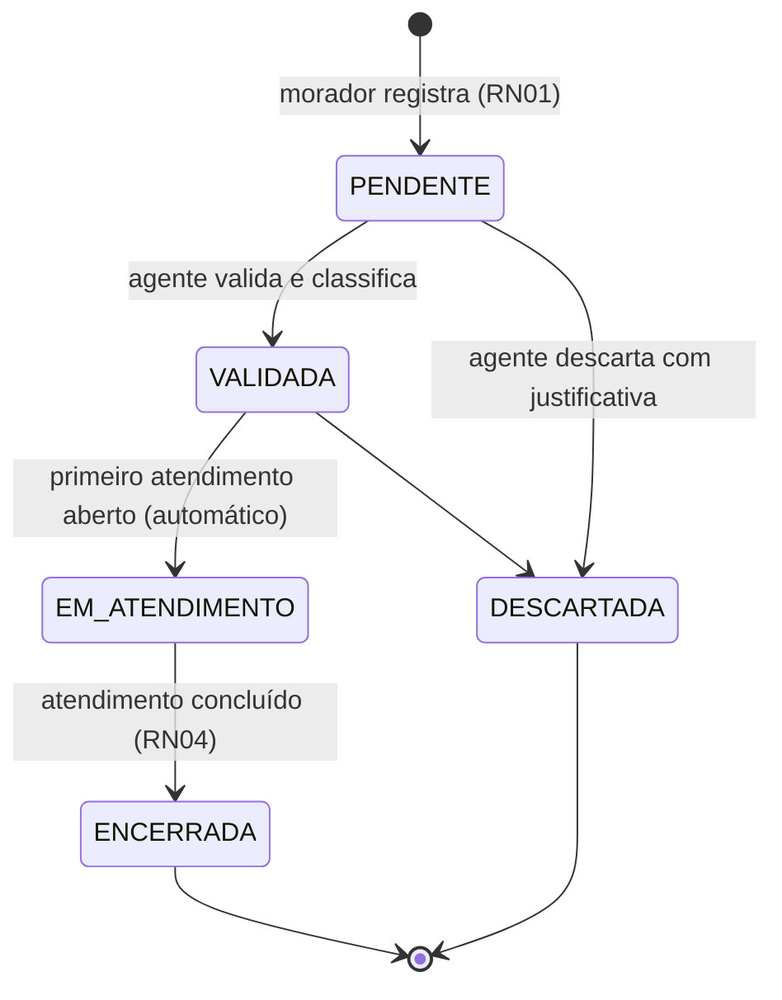

# Modelo de dados – Alerta Fogo Araguaia

Este documento descreve o modelo físico implementado em PostgreSQL. Ele parte do
Diagrama de Entidades e Relacionamentos (DER) elaborado no relatório da ação de
extensão (módulo 2) e registra os ajustes feitos durante a implementação.

## Diagrama de Entidades e Relacionamentos

## Ajustes em relação ao DER do módulo 2

| Tabela | Ajuste | Motivo |
|---|---|---|
| `ocorrencia` | `id_validador`, `validada_em` | Registrar quem validou e quando (RN03, auditoria). |
| `ocorrencia` | `justificativa_descarte` | RN04 exige justificativa para descartar. |
| `ocorrencia` | `criado_em` | Separar o momento do avistamento (`data_hora`) do envio, para medir o tempo de resposta. |
| `usuario` | `cargo`, `matricula`, `recebe_alertas`, `ativo` | Atributos das subclasses `AgentePublico` e `Morador` do diagrama de classe (herança em tabela única) e desativação de conta (LGPD). |
| `alerta` | `id_ocorrencia` | Relacionar o alerta à ocorrência que o motivou (RN02). |
| todas | `TIMESTAMPTZ` no lugar de `TIMESTAMP` | Guardar o fuso horário (America/Cuiaba, UTC−4) e evitar ambiguidade com dados de satélite em UTC. |
| todas | `GENERATED BY DEFAULT AS IDENTITY` | Forma padrão SQL de chave substituta autoincrementada. |

## Normalização

O esquema está na **terceira forma normal (3FN)**:

* **1FN** – todos os atributos são atômicos; fotos e atendimentos, que são
  multivalorados em relação à ocorrência, ficam em tabelas próprias.
* **2FN** – todas as chaves primárias são simples (uma coluna), então não há
  dependência parcial.
* **3FN** – nenhum atributo não chave depende de outro atributo não chave:
  dados do órgão ficam em `orgao`, e não repetidos em `usuario` ou
  `atendimento`; dados da localidade ficam em `localidade`.

A latitude e a longitude aparecem em `ocorrencia` e em `localidade` de propósito:
na localidade indicam o ponto de referência da região; na ocorrência, o ponto
exato do foco informado pelo GPS. Não são o mesmo fato, portanto não há redundância.

## Restrições implementadas

| Tipo | Exemplos |
|---|---|
| Chave primária | `pk_ocorrencia`, `pk_usuario`, ... (uma por tabela) |
| Chave estrangeira | 12 FKs com ações `RESTRICT`, `CASCADE` (`foto`) e `SET NULL` (`foco_satelite`, `alerta.id_ocorrencia`) |
| Unicidade | e-mail do usuário, nome do órgão e da localidade, caminho da foto, foco (satélite + data + posição) |
| Domínio (`CHECK`/`ENUM`) | perfis, status, nível de risco, tipos de órgão e localidade, gravidade 1–3, coordenadas válidas, formato de e-mail e de imagem, `fim >= inicio` |
| Regras de negócio (triggers) | RN01, RN03, RN04, limite de 5 fotos (RF03), transições de status |

## Ciclo de vida da ocorrência

